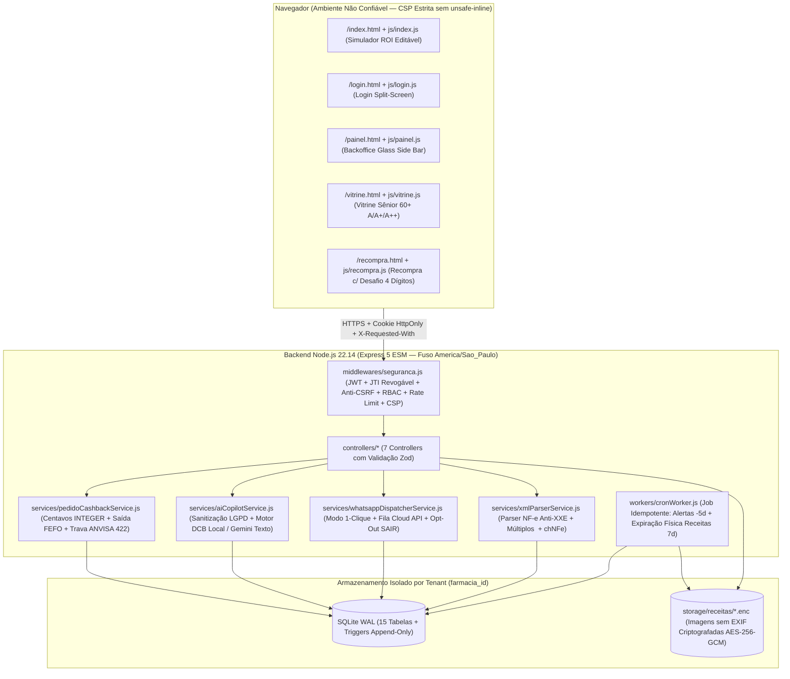

# 🗂️ Documentação Técnica de Arquitetura, Arquivos, API e Governança LGPD — FarmaLink Pro v3.2

Este documento descreve a arquitetura de software (**Método ENDS**), o papel de cada arquivo e função do código-fonte, as variáveis de ambiente, o contrato das rotas REST (referência OpenAPI), a governança de dados sensíveis de saúde (RIPD / LGPD) e o guia de deploy com Docker.

Para a visão comercial e guia rápido de demonstração, consulte [`README.md`](./README.md).

---

## 🏛️ 1. Diagrama de Arquitetura (Método ENDS + Camadas de Segurança)



---

## 📂 2. Mapa Detalhado de Todos os Arquivos e Suas Funções

### 2.1. Camada de Banco de Dados (`sql/`)

#### 📄 [`sql/schema.sql`](./sql/schema.sql)
Modelagem relacional com **15 tabelas**, todas com valores monetários em **centavos inteiros (`INTEGER`)**, chaves estrangeiras ativas (`PRAGMA foreign_keys = ON`) e **4 Triggers Append-Only**:
1. `farmacias`: Dados regulatórios da RDC 44/2009 (`razao_social`, `cnpj`, `afe_anvisa`, `licenca_sanitaria`, `horario_funcionamento`, `endereco_completo`, `farmaceutico_rt_nome`, `farmaceutico_rt_crf`, `dpo_email`, `telefone_sac`), parâmetros financeiros em centavos (`pedido_minimo_centavos`, `taxa_entrega_centavos`, `meta_mensal_centavos`, `cashback_pct`, `cashback_teto_pedido_pct`, `taxa_marketplace_ref_pct`) e feature flags (`plano_ativo`, `modo_whatsapp`).
2. `usuarios`: Contas internas por `farmacia_id` com `cargo` (`DIRETOR`, `FARMACEUTICO`, `BALCONISTA`), `cpf` único (11 dígitos), `senha_hash` (bcrypt), `crf_uf`, `totp_habilitado`, controle de bloqueio (`tentativas_falhas`, `bloqueado_ate`) e metas/comissões em centavos.
3. `sessoes_ativas`: Controle de sessões emitidas por `jti` (UUID v4) com flag `revogada` para invalidação imediata no logout ou troca de senha.
4. `clientes`: Cadastro por farmácia com `saldo_cashback_centavos` (`CHECK >= 0`), consentimentos separados (`lgpd_consentimento_saude_em` e `lgpd_optin_comunicacao_em`), `anonimizado_em` e `total_gasto_centavos`.
5. `produtos`: Catálogo com `ean_gtin`, `nome_comercial`, `principio_ativo`, `laboratorio`, `categoria`, `preco_custo_centavos`, `preco_venda_centavos`, `preco_promo_centavos`, `exige_receita` (trava ANVISA), `exibir_na_vitrine`, `estoque_total` (sincronizado via lotes FEFO) e `imagem_url` (SVG Data-URI ou foto).
6. `tratamentos_continuos`: Monitoramento do Módulo A com `duracao_dias` (30/60/90), `dias_antecedencia_alerta` (2 a 15), `data_ultima_compra`, `data_disparo_whatsapp`, `receita_valida_ate`, `status_recompra` (incluindo `AGUARDANDO_VALIDACAO_RT`), `valor_recuperado_centavos`, `token_recompra_hash` (SHA-256) e `token_expira_em`.
7. `lotes_estoque`: Fonte única de estoque com `numero_lote`, `nota_fiscal_ref`, `quantidade_atual`, `custo_unitario_centavos`, `data_validade`, `acao_queima_ativa`, `desconto_aplicado_pct`, `comissao_extra_balconista_pct` e `unidades_salvas`.
8. `orcamentos_receita`: Triagem do Módulo C com `consentimento_lgpd_receita` (`CHECK = 1`), `medico_proibiu_substituicao`, `imagem_receita_path` (arquivo `.enc` AES-256-GCM), `imagem_expira_em` (+7 dias), `texto_informado` (sanitizado), `valor_ref_centavos`, `valor_otimizado_centavos` e `margem_ganha_centavos`.
9. `itens_orcamento_ia`: Itens extraídos da prescrição comparando `produto_referencia_id` vs. `produto_sugerido_id` (menor preço para o paciente) e flag `substituicao_bloqueada`.
10. `pedidos_vitrine`: Pedidos de delivery com `codigo_pedido`, `chave_idempotencia`, `subtotal_centavos`, `taxa_entrega_centavos`, `cashback_usado_centavos`, `cashback_gerado_centavos`, `total_centavos`, `economia_mkt_centavos`, `status_pedido` (`AGUARDANDO_VALIDACAO_RT`, `NOVO`, `SEPARANDO`, `SAIU_ENTREGA`, `CONCLUIDO`, `CANCELADO`, `DEVOLVIDO`) e `validado_por_rt_id`.
11. `movimentacoes_cashback`: Extrato contábil em centavos (`CREDITO`, `RESGATE`, `ESTORNO`) com `UNIQUE(pedido_id, tipo)`.
12. `checklists_anvisa`: Registros internos de POPs com `tipo_pop`, `valor_medido`, `dentro_conformidade`, `observacao`, `assinado_por_usuario_id` e `hash_integridade` (SHA-256).
13. `fila_whatsapp`: Fila persistente com `chave_idempotencia`, `modo_envio`, `tipo_disparo`, `status_fila`, `tentativas` e `proxima_tentativa_em`.
14. `execucoes_idempotentes`: Chaves únicas de execução do worker e de notas fiscais importadas (`nfe_xml:<farmacia_id>:<chNFe>`).
15. `logs_auditoria`: Trilha de auditoria append-only com `correlation_id`.
- **Triggers Append-Only:** `trg_logs_auditoria_no_update`, `trg_logs_auditoria_no_delete`, `trg_checklists_anvisa_no_update` e `trg_checklists_anvisa_no_delete`.

---

### 2.2. Camada de Backend (`backend/`)

| Arquivo | Funções Exportadas | Descrição Funcional |
| :--- | :--- | :--- |
| [`config/env.js`](./backend/config/env.js) | `env` | Carrega `.env`, força `TZ=America/Sao_Paulo`, valida `JWT_SECRET` (≥ 32 chars) e **aborta o boot (`process.exit(1)`) se `NODE_ENV=production` e `DEMO_MODE=true`**. |
| [`utils/comum.js`](./backend/utils/comum.js) | `hojeSP`, `somarDias`, `ajustarDiaDisparo`, `diffDias`, `faixaRisco`, `paraCentavos`, `deCentavos`, `dinheiro`, `hashSha256`, `anonimizarTextoReceita`, `removerExifJpeg`, `criptografarBuffer`, `descriptografarBuffer`, `normalizarWhatsapp`, `linkWaMe`, `log`, `HttpError` | Aritmética inteira em centavos, ajuste de domingo para sábado nos disparos, remoção de CPF/CRM/telefone de textos clínicos, remoção de segmentos EXIF/APP1 de JPEGs e criptografia autenticada **AES-256-GCM**. |
| [`database/conexao.js`](./backend/database/conexao.js) | `abrirBanco`, `getDb`, `all`, `get`, `run`, `tx`, `marcarExecucao`, `sincronizarEstoqueProduto`, `consumirEstoqueFEFO`, `fecharBanco`, `snapshot` | Gerencia o SQLite em modo WAL, transações ACID (`BEGIN IMMEDIATE`), backup quente (`VACUUM INTO`) e o **Motor FEFO** que abate sempre do lote válido com vencimento mais próximo e recalcula `produtos.estoque_total`. |
| [`database/seed.js`](./backend/database/seed.js) | `SENHA_DEMO`, `TOKEN_DEMO_MARIA`, `bancoVazio`, `popularSeeds` | Fonte única de seeds de demonstração (sem marcas registradas de terceiros), criando lotes reais para cada produto e sincronizando o estoque via FEFO. |
| [`database/reset.js`](./backend/database/reset.js) | *(Script CLI)* | Remove o arquivo `.sqlite` local e recria a base limpa de demonstração (`npm run reset-db`). |
| [`middlewares/seguranca.js`](./backend/middlewares/seguranca.js) | `COOKIE_SESSAO`, `emitirSessao`, `encerrarSessao`, `exigirAuth`, `exigirCargo`, `recursosDoPlano`, `exigirRecurso`, `exigirDemoMode`, `rateLimit`, `headersSeguranca`, `correlationId`, `auditar`, `tratarErros` | Valida JWT com verificação de `jti` na tabela `sessoes_ativas`, exige header Anti-CSRF `X-Requested-With: FarmaLinkHttpRequest` em mutações, aplica CSP **sem `unsafe-inline`**, aplica `Referrer-Policy: no-referrer` na recompra e formata erros sem expor stack trace. |
| [`services/aiCopilotService.js`](./backend/services/aiCopilotService.js) | `extrairItensLocal`, `lerReceita`, `gerarProdutoLocal`, `gerarProduto` | Processa exclusivamente texto clínico sanitizado (nunca envia imagem de receita para IA externa) e gera cadastros de produtos livres para a Vitrine. |
| [`services/pedidoCashbackService.js`](./backend/services/pedidoCashbackService.js) | `formatarPedido`, `criarPedido`, `atualizarStatusPedido`, `listarPedidos` | Cria pedidos em centavos consumindo lotes por FEFO, bloqueia tarjados na vitrine (`HTTP 422`), retém recompras de tarjados em `AGUARDANDO_VALIDACAO_RT`, aplica teto de 30% no cashback, estorna cashback em `DEVOLVIDO` e gera convite pós-venda neutro. |
| [`services/whatsappDispatcherService.js`](./backend/services/whatsappDispatcherService.js) | `modoEfetivo`, `enfileirar`, `processarFila`, `processarInboundOptOut` | Enfileira mensagens de forma idempotente, processa envios via Cloud API Meta com backoff/DLQ e trata respostas `"SAIR"` / `"PARAR"` cancelando lembretes automaticamente. |
| [`services/xmlParserService.js`](./backend/services/xmlParserService.js) | `parseNFe` | Valida tamanho (≤ 1,5 MB), bloqueia `<!DOCTYPE`/`<!ENTITY` (Anti-XXE), extrai chave de 44 dígitos (`chNFe`) e lê múltiplos blocos `<rastro>` por produto. |
| [`controllers/authController.js`](./backend/controllers/authController.js) | `login`, `logout`, `me`, `salvarPreferencias`, `alterarSenha`, `criarUsuario`, `listarUsuarios`, `demoTrocarCargo`, `demoLoginRapido`, `demoAlterarPlano`, `configPublica` | Login com bloqueio após 5 falhas (`HTTP 423`), verificação 2FA quando habilitado, revogação de `jti` no logout, troca de senha e CRUD de usuários pelo Diretor. |
| [`controllers/dashboardController.js`](./backend/controllers/dashboardController.js) | `resumoExecutivo` | Retorna KPIs contábeis estritamente separados (Faturamento de Recompras, Comissão Evitada Estimada, Custo de Estoque Salvo, Lucro Bruto de Receitas Convertidas e Passivo de Cashback). |
| [`controllers/usoContinuoController.js`](./backend/controllers/usoContinuoController.js) | `cadastrar`, `listar`, `dispararUm`, `dispararLote`, `cancelar`, `confirmarCliqueWhatsapp`, `recompraVer`, `recompraConfirmar` | Gera lembretes neutros sem nome de medicamento, armazena token como hash SHA-256, exige confirmação dos 4 últimos dígitos do WhatsApp na página pública e retém tarjados para validação do(a) RT. |
| [`controllers/vitrineController.js`](./backend/controllers/vitrineController.js) | `resolverFarmaciaPublica`, `catalogo`, `criarPedidoPublico`, `pedidosListar`, `pedidoStatus`, `produtosListar`, `produtoGerarIA`, `produtoCriar` | Serve catálogo público com dados completos da RDC 44/2009 (`AFE`, `Licença Sanitária`, `RT`, `SAC`, `DPO`), cria lote FEFO inicial ao cadastrar produto e gerencia a esteira de delivery. |
| [`controllers/triagemIaController.js`](./backend/controllers/triagemIaController.js) | `receberReceita`, `processarReceita`, `listar`, `imagem`, `aprovarEnviar`, `finalizar`, `demoSimular` | Remove EXIF, criptografa fotos de receitas com AES-256-GCM, respeita trava `medico_proibiu_substituicao` e prioriza o genérico intercambiável de menor preço ao paciente. |
| [`controllers/radarValidadeController.js`](./backend/controllers/radarValidadeController.js) | `listar`, `cadastrarLote`, `importarXmlNFe`, `ativarAcaoQueima`, `registrarVendaLote` | Garante idempotência por `chNFe` (`HTTP 409` em nota duplicada), bloqueia venda de lotes vencidos (`HTTP 422`) e sincroniza o estoque total. |
| [`controllers/hubOperacionalController.js`](./backend/controllers/hubOperacionalController.js) | `listarHub`, `registrarChecklist`, `atualizarConfigFarmacia`, `listarAuditoria`, `exportarDadosTitular`, `anonimizarTitular`, `sincronizarEstoqueErp` | Registra POPs com hash SHA-256, implementa os endpoints de Portabilidade e Anonimização LGPD (Art. 18) e o conector de sincronização ERP. |
| [`workers/cronWorker.js`](./backend/workers/cronWorker.js) | `executarCicloWorker` | Promove alertas de uso contínuo, remove do disco arquivos `.enc` de receitas expiradas (7 dias) e processa a fila do WhatsApp. *(Nota operacional: em deploy multi-instância, deve rodar em processo único ou com lock distribuído).* |
| [`routes/apiRoutes.js`](./backend/routes/apiRoutes.js) | `apiRouter` | Registra todas as rotas REST e aplica os middlewares de autenticação, RBAC, Feature Flags e Rate Limiting. |
| [`server.js`](./backend/server.js) | `criarApp` | Inicializa o Express 5, aplica cabeçalhos de segurança, serve o frontend estático e executa *Graceful Shutdown* em `SIGINT`/`SIGTERM`. |
| [`test_suite.js`](./backend/test_suite.js) | *(Suíte de Testes)* | Executa **19 cenários automatizados** cobrindo todos os requisitos críticos, de segurança, lógica contábil e limpeza (`npm test`). |

---

### 2.3. Camada de Frontend (`frontend/`)

| Arquivo | Papel e Conformidade |
| :--- | :--- |
| [`css/glass-sidebar.css`](./frontend/css/glass-sidebar.css) | Design system do Showroom e do Backoffice **sem nenhum estilo inline**, usando `<progress class="progress-native">`, suporte a `@media (prefers-reduced-motion: reduce)`, Tema Escuro/Claro e Modo Alto Contraste (`data-contrast="high"`). |
| [`css/vitrine.css`](./frontend/css/vitrine.css) | Design system da Vitrine Sênior 60+ e Recompra com escala em `rem` (`18px`, `21px A+`, `24px A++`), botões ≥ `52px` e Modo Alto Contraste. |
| [`js/auth.js`](./frontend/js/auth.js) | Envia automaticamente `X-Requested-With: FarmaLinkHttpRequest` em todas as chamadas `apiFetch()`, gerencia *Focus Trap* acessível nos modais (`ativarFocusTrap`), escape contra XSS (`esc`), Tema e Alto Contraste. |
| [`index.html`](./frontend/index.html) + [`js/index.js`](./frontend/js/index.js) | Showroom Comercial e Calculadora de ROI com **premissas editáveis** (*Ticket Médio*, *% Conversão*, *% Taxa Marketplace*) e resultados separados por categoria contábil. |
| [`login.html`](./frontend/login.html) + [`js/login.js`](./frontend/js/login.js) | Login Split-Screen com suporte a atalhos de demonstração apenas quando `DEMO_MODE=true`. |
| [`painel.html`](./frontend/painel.html) + [`js/painel.js`](./frontend/js/painel.js) | Backoffice SPA de 6 abas com Simulador de Smartphone WhatsApp (exibindo mensagens neutras), validação RT de recompras de tarjados, comparador ético de receitas e painel de Portabilidade/Anonimização LGPD Art. 18. |
| [`vitrine.html`](./frontend/vitrine.html) + [`js/vitrine.js`](./frontend/js/vitrine.js) | Vitrine Sênior 60+ com ilustrações SVG por produto, 3 níveis de fonte, Alto Contraste, botão **"📞 Falar com Atendente"**, checkbox *"Médico proibiu substituição"* no envio de receita e rodapé completo RDC 44/2009 (`AFE`, `Licença Sanitária`, `RT`, `SAC`, `DPO`). |
| [`recompra.html`](./frontend/recompra.html) + [`js/recompra.js`](./frontend/js/recompra.js) | Página de Recompra com desafio de verificação dos **4 últimos dígitos do WhatsApp** antes de revelar o nome do medicamento e o saldo de cashback. |

---

## ⚙️ 3. Tabela de Variáveis de Ambiente (`backend/.env`)

| Variável | Padrão (Dev) | Obrigatória em Prod? | Descrição |
| :--- | :--- | :---: | :--- |
| `NODE_ENV` | `development` | **Sim** (`production`) | Define o modo de execução. Em `production`, ativa cookies `Secure`, HSTS e proíbe `DEMO_MODE=true`. |
| `PORT` | `3000` | Não | Porta TCP onde o servidor HTTP Express escuta. |
| `TZ` | `America/Sao_Paulo` | **Sim** | Fuso horário para cálculo de datas de disparo e validade de lotes. |
| `JWT_SECRET` | *(Hash dev)* | **Sim** (≥ 32 chars) | Chave secreta para assinatura de tokens JWT e derivação da chave AES-256-GCM das imagens de receitas. |
| `DEMO_MODE` | `true` (em dev) | **Sim** (`false`) | Habilita rotas de apresentação (`/demo-login`, `/self-heal`). **O servidor recusa iniciar se `NODE_ENV=production` e `DEMO_MODE=true`.** |
| `DB_PATH` | `backend/database/farmalink.sqlite` | Não | Caminho absoluto do arquivo de banco de dados SQLite. |
| `STORAGE_DIR` | `backend/storage` | Não | Diretório privado (fora do `frontend/`) onde ficam os backups e as imagens `.enc` de receitas. |
| `PUBLIC_BASE_URL` | `http://localhost:3000` | **Sim** | URL base usada na geração dos links públicos de reposição (`/recompra.html?t=...`). |
| `GEMINI_API_KEY` | `""` | Opcional | Chave da API Google Gemini (usada apenas para texto clínico sanitizado). Sem chave, usa o motor determinístico DCB local. |
| `GEMINI_MODEL` | `gemini-2.5-flash` | Não | Modelo Gemini utilizado quando `GEMINI_API_KEY` está configurada. |
| `META_WA_TOKEN` | `""` | Opcional | Token Bearer da WhatsApp Cloud API Oficial da Meta. |
| `META_WA_PHONE_ID` | `""` | Opcional | ID do número de telefone registrado na Meta Cloud API. |

---

## 📡 4. Referência da API REST (Contrato de Endpoints)

Todas as rotas autenticadas exigem o cookie `HttpOnly` `fl_session` (com `jti` ativo em `sessoes_ativas`) e, para métodos `POST`/`PATCH`/`DELETE`, o cabeçalho `X-Requested-With: FarmaLinkHttpRequest`.

### 4.1. Rotas Públicas e Webhooks
- `GET /api/health` ➔ Status do serviço, versão (`3.1.0`), timezone e estado de `demo_mode`.
- `GET /api/v1/public/config` ➔ Indica se o servidor está em modo demonstração.
- `POST /api/v1/auth/login` ➔ Autentica colaborador (`email`, `senha`, `codigo_2fa` opcional), aplica bloqueio após 5 falhas (`HTTP 423`) e emite sessão `jti`.
- `POST /api/v1/auth/logout` ➔ Revoga o `jti` no banco (`sessoes_ativas.revogada = 1`) e limpa o cookie.
- `GET /api/v1/public/vitrine` ➔ Catálogo de produtos isentos de prescrição (`exige_receita = 0`) + dados regulatórios da farmácia (RDC 44/2009).
- `POST /api/v1/public/pedidos` ➔ Cria pedido da Vitrine (suporta `Idempotency-Key`, consome lotes via FEFO e rejeita itens tarjados com `HTTP 422`).
- `POST /api/v1/public/receitas` ➔ Recebe receita médica com `consentimento_lgpd: true`, flag `medico_proibiu_substituicao`, sanitiza o texto e criptografa eventual imagem em AES-256-GCM.
- `GET /api/v1/public/recompra/:token?ultimos4=XXXX` ➔ Consulta token de reposição (`Referrer-Policy: no-referrer`). Só revela o nome do medicamento e saldo de cashback se `ultimos4` coincidir com o telefone do titular.
- `POST /api/v1/public/recompra/:token/confirmar` ➔ Confirma reposição validando `ultimos4_telefone`, invalida o token (uso único) e retém medicamentos tarjados em `AGUARDANDO_VALIDACAO_RT`.
- `POST /api/v1/webhooks/whatsapp-inbound` ➔ Processa mensagens recebidas (`{ from, text }`); caso `text` seja `"SAIR"` ou `"PARAR"`, revoga o opt-in e cancela os lembretes ativos.

### 4.2. Rotas Autenticadas (`/api/v1/*`)
- `GET /api/v1/auth/me` | `PATCH /api/v1/auth/preferencias` | `POST /api/v1/auth/alterar-senha`
- `GET /api/v1/usuarios` | `POST /api/v1/usuarios` *(RBAC: `DIRETOR`)*
- `GET /api/v1/dashboard` ➔ KPIs contábeis separados e ações prioritárias.
- `GET /api/v1/uso-continuo?page=1&limit=100` | `POST /api/v1/uso-continuo` | `POST /api/v1/uso-continuo/:id/disparar` | `POST /api/v1/uso-continuo/disparar-lote` | `POST /api/v1/uso-continuo/:id/cancelar`
- `GET /api/v1/vitrine/pedidos?page=1&limit=50` | `PATCH /api/v1/vitrine/pedidos/:id/status` | `GET /api/v1/vitrine/produtos` | `POST /api/v1/vitrine/produtos` | `POST /api/v1/vitrine/produtos/gerar-ia`
- `GET /api/v1/triagem-ia` | `GET /api/v1/triagem-ia/:id/imagem` *(descriptografa AES-256-GCM e audita acesso)* | `POST /api/v1/triagem-ia/:id/aprovar-enviar` | `PATCH /api/v1/triagem-ia/:id/finalizar`
- `GET /api/v1/radar-validade` | `POST /api/v1/radar-validade/lotes` | `POST /api/v1/radar-validade/importar-xml` *(idempotente por `chNFe`)* | `POST /api/v1/radar-validade/lotes/:id/acao` | `POST /api/v1/radar-validade/lotes/:id/vender`
- `GET /api/v1/hub-operacional` | `POST /api/v1/hub-operacional/checklists` | `PATCH /api/v1/hub-operacional/config-farmacia` | `GET /api/v1/hub-operacional/auditoria`
- `GET /api/v1/lgpd/titular/:whatsapp` *(Portabilidade JSON — LGPD Art. 18)* | `POST /api/v1/lgpd/titular/anonimizar` *(Anonimização — LGPD Art. 18)*
- `POST /api/v1/integracoes/erp-sync` *(Sincronização de lotes e preços com ERP de frente de loja)*

---

## 🔒 5. Resumo do Relatório de Impacto à Proteção de Dados Pessoais (RIPD / LGPD Saúde)

1. **Papéis dos Agentes de Tratamento (LGPD Art. 5º, VI e VII):**
   - **Controladora:** A Farmácia contratante (define a finalidade do atendimento farmacêutico e dispensação).
   - **Operadora:** A Tricode / Plataforma FarmaLink Pro (realiza o processamento técnico segundo as instruções da Controladora).
2. **Bases Legais (LGPD Art. 7º e Art. 11):**
   - *Dados Sensíveis de Saúde (Receitas e Tratamentos Contínuos):* Consentimento específico e destacado do titular (`Art. 11, I`) e tutela da saúde em procedimento realizado por profissionais de saúde/serviços farmacêuticos (`Art. 11, II, f`).
   - *Lembretes de Reposição no WhatsApp:* Opt-in específico separado (`lgpd_optin_comunicacao_em`), com mecanismo imediato e gratuito de opt-out (`"SAIR"`).
3. **Medidas Técnicas de Mitigação de Risco:**
   - **Zero Transferência Internacional de Imagem de Receita:** Fotos de receitas médicas nunca são enviadas a APIs externas de IA.
   - **Remoção de EXIF e Criptografia em Repouso:** Imagens têm metadados EXIF removidos e são cifradas com `AES-256-GCM` antes da escrita em disco.
   - **Política de Retenção e Descarte:** Imagens criptografadas de receitas expiram e são removidas fisicamente do disco pelo `cronWorker.js` após **7 dias** (ou imediatamente após a conclusão/descarte do orçamento). Registros fiscais e de POPs sanitários são mantidos pelo prazo regulatório de 5 anos (ANVISA).
   - **Sigilo em Notificações:** Mensagens enviadas por WhatsApp não contêm nome de medicamento ou patologia.

---

## 🐳 6. Guia de Deploy com Docker e CI/CD

### Executando em Produção com Docker Compose
```bash
export JWT_SECRET="$(openssl rand -hex 32)"
docker compose up -d --build
```
O arquivo [`docker-compose.yml`](./docker-compose.yml) sobe o container Node `22.14.0-alpine` com `NODE_ENV=production`, `DEMO_MODE=false`, volumes persistentes para o banco (`farmalink_db`) e para os arquivos criptografados (`farmalink_storage`), além de `healthcheck` automático a cada 15 segundos.

### Integração Contínua (GitHub Actions)
O workflow [`.github/workflows/ci.yml`](./.github/workflows/ci.yml) executa automaticamente os **16 cenários de teste** (`npm test`) a cada `push` ou `pull_request`.

---

## 📈 7. Changelog & Roadmap

### Changelog
- **v3.2.0 (Atual):**
  - **Travas de Produção:** `criarApp()` e `popularSeeds()` recusam popular seeds fora do `DEMO_MODE` ou em `NODE_ENV=production`, e o boot aborta caso existam usuários `*.demo` em produção.
  - **Importador XML NF-e & ANVISA RDC 44/2009:** Produtos novos criados via XML nascem ocultos (`exibir_na_vitrine = 0`, `exige_receita = 1`, `pendente_classificacao = 1`) sem preço de venda inventado, exigindo classificação explícita (`PATCH /api/v1/vitrine/produtos/:id/classificar`). Notas sem tag `<dVal>` são rejeitadas (`HTTP 422`) e a idempotência usa `chNFe` ou hash SHA-256 do XML (`HTTP 409`).
  - **Comparador Farmacêutico Seguro (Lei 9.787/99 e Lei 13.021/14):** Cruzamento por `principio_ativo` + `concentracao` (`50mg` ≠ `100mg`) + `forma_farmaceutica` + `tipo_medicamento` (`REFERENCIA` vs `GENERICO`), aviso explícito de itens sem estoque no orçamento e assinatura restrita ao cargo `FARMACEUTICO` com CRF ativo.
  - **Contabilidade, Fuso Horário (`America/Sao_Paulo`) e Estoque FEFO:** Fim da dupla contagem no faturamento mensal, timestamps gravados com `agoraSP()`, virada mensal automática de `vendas_mes_centavos`, expiração real de cashback vencido, `COMISSAO_BONUS_EQUIPE` isolada da vitrine, payload Meta Cloud API `type: "template"`, `.dockerignore` adicionado e `zod` atualizado (`0 vulnerabilities` no `npm audit`).
- **v3.0.0:** Showroom comercial com calculadora de ROI, Simulador de Smartphone WhatsApp e Layout Glass Side Bar.
- **v2.2.0:** Protótipo inicial Método ENDS.

### Roadmap Próximos Passos (Escala SaaS Multi-Loja)
1. Migração do driver local SQLite WAL para **PostgreSQL gerenciado com Row Level Security (RLS)** nativo para operação com múltiplas réplicas horizontais.
2. Homologação de webhooks nativos de pagamento PIX com PSPs (**Asaas / Efí**) e emissão automatizada de **NFC-e**.
3. Painel Super-Admin da Tricode para onboarding self-service de novas farmácias e gestão de assinaturas.
